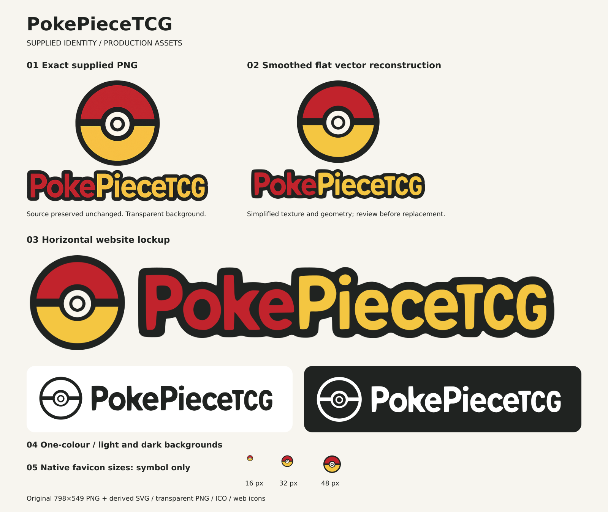

# PokePieceTCG — OneSimpleSite redesign

A research-backed, native WordPress / WooCommerce redesign for the existing IONOS-hosted shop. Prepared 6 November 2026. **Research and handoff are complete; website implementation has not started.**

## Start here

- [Full research and build specification](docs/redesign/README.md)
- [Claude implementation prompt](docs/redesign/07-CLAUDE-BUILD-PROMPT.md)
- [Latest curved navigation and motion direction](docs/redesign/10-CURVED-NAV-AND-MOTION.md)
- [Logo pack and usage guide](brand/README.md)
- [Sources and verification limits](docs/redesign/08-SOURCES.md)

## Direction

“The Collector's Counter”: warm cream and ink, restrained brand red/yellow, softly framed navigation, rounded controls, open product layouts and real product photography. Smooth component transitions support browsing and purchasing. Preserve the current page structure, URLs, hosting and commerce behaviour.

## Important build findings

The public catalogue combines sealed products, live openings and a standalone shipping upgrade. Its homepage currently features that shipping service, while many merchandise listings are unavailable. The implementation must handle truthful stock states and explicit fulfilment/condition information, exclude service products from merchandise discovery, and preserve the current purchase workflow.

The public site confirms WordPress/WooCommerce and strongly identifies WoodMart. Exact installed versions, licences, private settings and integrations require authorised admin inventory. Deliver a native theme/child-theme implementation; a separate JavaScript storefront is not the default architecture.

## Production integrity

Do not commit secrets, licence keys, customer data, order exports, backups or production configuration to this public repository. Use isolated protected staging. Promote approved files/content/configuration selectively; never overwrite live orders and stock with an old staging database.

