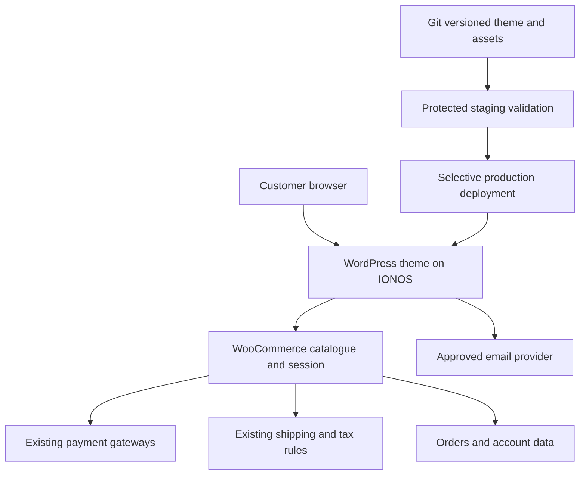

# 04 — Native architecture, integrations and IONOS delivery

## Architecture decision

**Recommended:** redesign the existing WordPress/WooCommerce installation in a protected staging copy and deliver a versioned theme/child theme plus explicit configuration/content changes. Woo remains the system of record. IONOS remains the host. Repository source is the build record, not a replacement database.



## Choose the implementation after discovery

| Route | Choose when | Avoid |
|---|---|---|
| Existing supported theme + child theme, restyled templates and existing builder | Parent licence, update path, performance and extension behaviour are satisfactory | Editing parent files; keeping an old demo layout just because it exists. |
| Purpose-built Woo-compatible classic theme | Existing presentation is unsalvageable; current classic checkout/hooks need preserving; team can complete all templates | A broad `woocommerce.php` override swallowing specialised template behaviour; gratuitous overrides. |
| Native block theme | Current extensions and checkout support Blocks, editor needs favour it, team verifies all parity | Switching classic checkout to Blocks merely for visual convenience. |
| Headless React/Next.js | Only after a separate justified architecture/scope decision | Defaulting to Vercel and assuming static files can be uploaded to WordPress/IONOS. |

The inferred WoodMart/Elementor stack makes a child theme the first route to investigate, not an instruction to preserve its appearance. Rebuild composition and components within a maintainable native implementation. Verify exact parent slug/version and licence ownership. If replacing the parent, catalogue all theme-provided behaviour: search, quick view, wishlist, cart fragments, product tabs, builder widgets and headers. Use official documentation for that exact theme; a similarly named XTemos/Basel article is not proof of WoodMart compatibility.

Prefer Woo hooks over copying templates; every unavoidable override records upstream version and reason [W01]. Separate storefront business logic from the theme in a small versioned plugin when genuinely needed. Keep PHP/WordPress/Woo compatibility aligned with the actual host, not model-memory versions. Do not install duplicate builders, search systems, caching plugins or SEO plugins.

## Suggested repository shape — implementation stage

```text
docs/redesign/                 this pack and living decision/evidence log
brand/                        supplied source and labelled derived artwork
wordpress/theme/              child/custom theme, PHP, styles and templates
wordpress/plugin/             only necessary site-specific behaviour
assets-src/                   editable CSS/JS/assets, if compilation is used
dist/                         reproducible installable ZIPs, manifest/checksums
scripts/                      packaging and selective deployment helpers
tests/                        meaningful commerce regression checks/fixtures
```

No production database, uploads dump, `wp-config.php`, `.env`, keys, customer email addresses, private licence files or order exports. Any staging copy containing real customers stays private with access control; use scrubbed data for developer machines and fixtures. Build-time Node tooling is fine; the production site must run in the verified PHP/WordPress environment without a persistent Node process.

## Integration register

| Capability | Authority and implementation | Required verification | Default/cost status |
|---|---|---|---|
| Products/prices/taxes/stock | Existing Woo database/settings | Product IDs, variants, currency minor units, stock/visibility/backorders, tax display | Retained core; hosting unchanged. |
| Product discovery | Existing theme/native Woo query + accurate attributes | Filters/counts/history/search aliases and all products reachable | Included UI; extra search licence only if justified/agreed. |
| Cart | Existing Woo session/native events or supported Store API | Correct session after refresh/login, quantity validation, stale state, rate/tax calculation | Included; one authoritative cart. |
| Checkout/payment | Existing active gateways, callback/webhook flow | Classic/Blocks compatibility, gateway sandbox, express/3DS/redirect/failure/retry | Retain merchant contract/fees; no new payment provider implied. |
| Shipping | Existing zones/methods/classes and shipping-upgrade product | UK/NI/excluded postcodes, thresholds, mixed basket, service eligibility, no double charge | Retained; rate changes require merchant decision. |
| Account | WordPress/Woo users and endpoints | Reset/login/register/orders/address and active extension endpoints | Retained. |
| Transactional email | Existing Woo mail path + verified sender authentication | Real received order/reset/refund/contact email, SPF/DKIM/DMARC, failure logs [W06] | Retain working setup; provider fees unknown until inspection. |
| Newsletter | Existing working provider first; MailPoet or another supported provider only if needed | Form → real list → consent record → actual mail/unsubscribe; source tagging | Provider/account/list and current pricing are blocking for activation; no assumed free plan. |
| Stock alerts | Existing compatible extension or separately approved official alternative | Product/variation match, single alert on real transition, unsubscribe and queue/cron | Optional; official Woo extension exists [W05], entitlement/cost unverified. |
| Contact | Current form/provider or equivalent verified replacement | Valid/invalid/rate-limited submissions and inbox receipt | Preserve workflow; optional phone not auto-removed. |
| SEO | Existing Rank Math configuration + Woo output, one canonical schema owner per type | Titles/canonicals/redirects/sitemaps/Product JSON-LD | Retain existing licence/tier; no guaranteed ranking. |
| Consent/analytics | Actual CMP/tag inventory | Optional tags blocked until appropriate permission; withdrawal, no duplicates | Existing first; new consent/analytics service requires decision. |
| TikTok | Existing link/manual process initially | Exact shop region, connector, SKU mapping, catalogue-vs-orders-vs-stock capability | New bidirectional sync is separate integration scope. A marketing catalogue connector does not prove UK stock/order sync [W07]. |

IONOS account capabilities are not a universal menu of included Woo features. The partner portal grants access to hosting/projects; Woo/theme/plugins provide storefront behaviour. Do not promise every feature a host advertises is licensed or enabled for this client.

## Cart/API constraints

For native server-rendered templates, use supported Woo helpers/events. If the Store API is needed for an enhancement, it supports customer-facing products/cart/checkout but is not an admin API [W04]. Use its documented session/nonce/cart-token rules; do not expose authenticated Woo REST consumer secrets to a browser. Keep requests same-origin, verify server-side permissions, escape output and validate inputs. The displayed cart total is always the server response, never `quantity × cached price` as the final authority.

Do not add a bespoke payment processor, reverse engineer gateway internals, create an independent stock service or use localStorage as the live basket. Cache public catalogue pages appropriately; exclude cart/checkout/account, personalised responses and relevant Woo session cookies. Test actual host/cache behaviour rather than assuming a LiteSpeed namespace means server page caching is configured correctly.

## IONOS and agency access

Agency access must be accepted by the client, and the level must permit the required project/hosting actions [I01,I02]. Partner access is not proof that WordPress administrator, SFTP/SSH, database, backups or plugin licensing are available. Confirm each separately. Use named agency users where possible; never ask the client for their main password in chat.

Record exact IONOS package, domain mapping, document root, PHP/memory/upload/execution limits, database version, storage, cron, SFTP/SSH and staging capability. If the account is not actually the WordPress hosting product expected, pause only the dependent deploy step and resolve architecture before installation. Do not change domain, DNS, nameservers, mailbox or unrelated hosting contracts to stage a redesign.

## Staging sequence

1. Inventory active theme/plugins, versions, licences, custom snippets, menus, widgets, editor templates, Woo system status, gateway modes, mail, taxes/shipping, analytics and scheduled actions.
2. Take private files/database backups and verify an isolated restore. Export theme/builder/SEO settings privately. Record page/product IDs, URLs and baseline commerce behaviours.
3. Create isolated staging with a separate database using the package's supported facility or an approved/manual clone [I03]. Access-protect it and add `noindex`; robots alone is not access control. Do not assume the host provides one-click staging.
4. Disable real gateway credentials, outgoing customer email, production webhooks, stock feeds and automations before browsing/making staging test orders. Use test recipients and gateway sandbox. Prevent duplicate scheduled jobs.
5. Build the whole presentation there. Carry all original functionality forward or record a specific parity blocker; do not silently delete a feature because its plugin looks old.
6. Test from a clean customer session as well as admin; perform the acceptance journeys in `06-DELIVERY-AND-QA.md`.

## Production deployment — selective, order-safe

Promote theme/plugin files, approved assets, deterministic content/template changes and explicitly listed settings. **Never overwrite the live Woo database with a stale staging copy.** New live orders, users, stock changes and payment metadata must survive. HPOS or legacy order storage differences make manual table copying especially unsuitable as a shortcut.

Create an allowlisted change manifest: file versions/checksums; page IDs whose content changes; required builder template IDs and URL remapping; theme options/menu assignments; product metadata changes approved individually. Apply repeatably and review before activation. Preserve production secrets, payment modes, mail recipients, analytics IDs, cron/webhooks, shipping/tax and existing SEO verification.

If schema/configuration work needs a maintenance window, agree the window and capture orders/stock state before it. Reconcile anything that arrived during the window. Deploy from the current production base. Regenerate necessary assets, purge the right caches, verify HTTPS, perform agreed smoke checks, remove production `noindex`/staging URLs and keep a release record.

Rollback first reverts presentation files/configuration/content through the change manifest. A full database restore would erase changes since backup, including orders, as IONOS explicitly warns [I04]; treat that as an incident-recovery decision with order reconciliation, never routine undo. Keep gateway/webhook/order evidence available privately.

## Optional integrations: activation policy

Build and demonstrate the component against labelled fixtures if access/provider is missing. Keep it disabled in the real shop and report the missing dependency. Installing a placeholder plugin or returning fake success is not integration. Before any paid extension/service purchase, present the current actual price, payer, renewal owner, functionality and alternative; approval is needed for that new spend, not for reversible design work.
